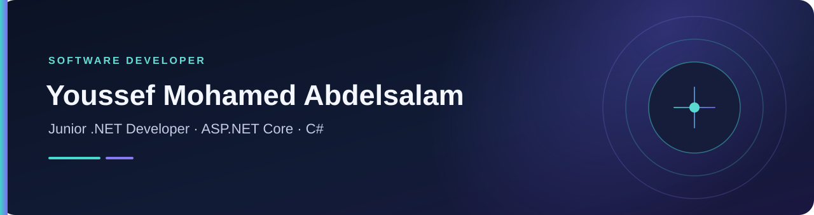

  
  

    
    
  

## About

I build web applications with **C#**, **ASP.NET Core MVC**, and **Entity Framework Core**. I’m interested in maintainable architecture, practical features, and responsive user experiences.

## Featured Projects

| Project | What it does |
| --- | --- |
| [Gym Management System](https://github.com/Youssef-Ym/ItiFinalProjectMvcGym) | Manages gym members, trainers, classes, schedules, and enrollments using ASP.NET Core MVC, Entity Framework Core, and SQL Server. |
| [E-Shop](https://github.com/Youssef-Ym/E-Shop) | E-commerce application with product management, shopping cart, checkout, and order processing. |
| [Online Education Website](https://github.com/Youssef-Ym/Projct-1) | Responsive HTML and CSS landing page for an online learning platform. |

## Tech Stack

  
  
  
  
  
  
  
  
  

**Practices:** Clean Architecture · Repository Pattern · Responsive Design

## Currently Learning

.NET 10, software design patterns, and clean code practices.

---

  Open to connecting and collaborating on .NET projects.

